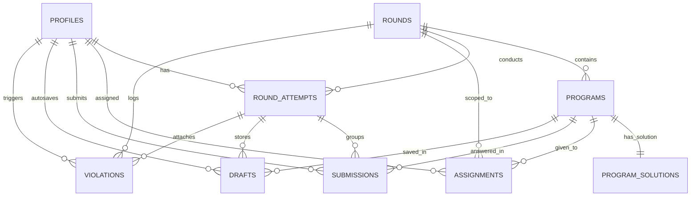

# Bug Bash Arena — Timed Bug-Finding Competition Platform

A secure, responsive, production-grade web platform where administrators coordinate a multi-round programming competition. Students diagnose defects and fix buggy codebases in an integrated Monaco code editor under a strict countdown timer, while administrators monitor submissions, countdowns, and security integrity violations in real time.

---

## 1. Highlights & Key Features

- **Multi-Round Competition Engine:**
  - **Round 1 (Rapid Code Debugging):** 10 buggy programs across Python, JavaScript, C++, and Java.
  - **Round 2 (Algorithm & Structural Flaws):** 5 intermediate algorithm defects (Dijkstra, LRU cache eviction, BST validation, Matrix spiral, Rate limiter).
  - **Round 3 (System Resilience & Concurrency):** 1–2 advanced concurrency defects (Distributed Lock lease expiry race condition, Promise concurrency pool deadlock).
  - Round states: `Draft` → `Ready` → `Live` → `Stopped` → `Completed`.
  - Independent attempt per student: each candidate has their own start trigger and dedicated countdown clock.

- **Server-Authoritative Timing:**
  - Server is the absolute source of truth for time (`started_at`, `ends_at` computed server-side via PostgreSQL RPC).
  - Browser countdown is display-only and re-syncs on load and periodically.
  - Page refresh or network disconnect resumes the exact attempt with the remaining time intact.
  - Hard deadline enforcement: submissions after `ends_at` are rejected at the database level.
  - Zero-time auto-submit: on reaching zero, the editor locks and latest saved drafts are automatically recorded.

- **Anti-Cheating & Exam Security Engine:**
  - Tab switch & window switch detection (`visibilitychange`, `document.hidden`).
  - Window blur / loss of focus tracking (`blur` on window).
  - Mandatory Fullscreen enforcement with Fullscreen API (`fullscreenchange`).
  - Clipboard actions blocked (copy, cut, paste, context menu right-click).
  - Configurable Grace Period (1–3 seconds) to avoid false positives from browser alerts or OS notifications.
  - Configurable Strict Mode (instant termination on first infraction) vs. Warning Mode (N warnings before termination).
  - Real-time violation logging (`student_id`, `round_id`, `attempt_id`, `violation_type`, `details`, `user_agent`, `created_at`).
  - Admin Re-allow capability: administrators can unblock a terminated student and grant additional time directly from the live monitor.

- **Monaco Code Editor & Diff Viewer:**
  - Student Arena: Syntax highlighting, line numbers, font customization, autosave every 3 seconds to the database, reset-to-original-buggy-code button, per-program submission.
  - Admin Diff Viewer: Side-by-side Monaco Diff comparison:
    1. Student Submitted Code vs. Original Buggy Code
    2. Student Submitted Code vs. Hidden Reference Solution

- **Enterprise Database Security (PostgreSQL & RLS):**
  - Row Level Security (RLS) enabled on all 10 tables.
  - Reference solutions are stored in an isolated table (`program_solutions`) with ZERO read permissions for students.
  - Students can only view their own profile, assigned programs, attempts, drafts, and submissions.
  - Realtime publication via Supabase Realtime for instant synchronization.

---

## 2. Tech Stack

| Layer | Technology |
|---|---|
| **Frontend** | React 18, TypeScript, Vite, Tailwind CSS, Lucide Icons |
| **Code Editor** | Monaco Editor (`@monaco-editor/react`, `monaco-editor`) |
| **Backend / DB** | Supabase (PostgreSQL, Row Level Security, Realtime, RPC Functions) |
| **Analytics & Charts** | Recharts (Responsive bar charts, pie charts, KPI meters) |
| **UI Components** | Custom design system modeled after shadcn/ui principles |
| **Celebrations** | Canvas Confetti |

---

## 3. Database Architecture (Supabase PostgreSQL)



### Table Definitions

1. `profiles`: `id` (references auth.users), `role` (`admin` | `student`), `full_name`, `roll_no`, `email`, `created_at`.
2. `exam_settings`: `strict_mode`, `max_warnings`, `block_copy_paste`, `require_fullscreen`, `grace_period_seconds`.
3. `rounds`: `round_number` (1, 2, 3), `name`, `description`, `duration_minutes`, `status`, `started_at`, `ended_at`.
4. `programs`: `round_id`, `title`, `language`, `description`, `buggy_code`, `points`, `created_at`.
5. `program_solutions`: `program_id` (PK), `reference_solution` (strictly admin-only).
6. `assignments`: `student_id`, `program_id`, `round_id`, `created_at`.
7. `round_attempts`: `student_id`, `round_id`, `started_at`, `ends_at`, `completed_at`, `status`, `termination_reason`, `warnings_count`.
8. `submissions`: `attempt_id`, `program_id`, `student_id`, `code`, `status`, `submitted_at`, `score`.
9. `drafts`: `attempt_id`, `program_id`, `student_id`, `code`, `updated_at`.
10. `violations`: `student_id`, `round_id`, `attempt_id`, `violation_type`, `details`, `user_agent`, `created_at`.

### Server Stored Procedures / RPC Functions

- `public.start_round_attempt(p_round_id UUID)`: Atomically validates round status and computes `started_at = now()` and `ends_at = now() + (duration_minutes * interval '1 minute')`.
- `public.save_draft(p_attempt_id UUID, p_program_id UUID, p_code TEXT)`: Enforces `now() <= ends_at` and upserts to `drafts`.
- `public.submit_program(p_attempt_id UUID, p_program_id UUID, p_code TEXT)`: Rejects submissions if timestamp exceeds `ends_at`.
- `public.record_violation(p_attempt_id, p_round_id, p_violation_type, p_details, p_user_agent)`: Inserts violation audit and triggers attempt termination if in strict mode or max warnings exceeded.
- `public.reallow_student(p_attempt_id UUID, p_additional_minutes INT)`: Admin RPC to unlock attempt and grant time.

---

## 4. Anti-Cheating & Exam Security: Technical Limitations

> [!WARNING]
> **Advisory on Web Browser Sandboxing & Security Boundaries**
> 
> Modern web browsers operate inside secure operating system sandboxes. While Bug Bash Arena leverages all available browser APIs (`visibilitychange`, `window.blur`, `fullscreenchange`, clipboard event cancellation), administrators and proctors should understand inherent web platform limitations:
> 
> 1. **Secondary Displays / Multi-Monitor:** Browsers cannot determine what applications are open on a second monitor unless window focus shifts or the student leaves fullscreen.
> 2. **External Hardware / Mobile Devices:** The browser cannot detect physical phones, secondary laptops, tablets, or printed documentation positioned beside the keyboard.
> 3. **Virtual Machines & Screen Mirroring:** A browser running inside an isolated VM cannot inspect the host operating system or external hypervisor.
> 4. **Screenshots & OS Overlays:** The browser cannot prevent OS-level screen captures (e.g., Windows Snipping Tool) or non-browser screen recording utilities.
> 
> **Conclusion:** These automated security measures deter, detect, and record casual cheating, tab-hopping, and copy-paste shortcuts. They are intended to **supplement, not replace, physical or human proctoring in an examination venue**.

---

## 5. Setup & Installation Guide

### Prerequisites
- Node.js 18+ (tested with v20+)
- npm or pnpm
- (Optional) Free Supabase project for cloud deployment

### Option A: Immediate Local Interactive Mode (Zero Cloud Setup Needed)
Bug Bash Arena includes a built-in interactive offline engine with all 17 realistic buggy programs, 5 candidates, and simulated realtime events:

```bash
# 1. Clone or navigate to the project directory
cd bug-bash-arena

# 2. Install dependencies
npm install

# 3. Start local development server
npm run dev
```

Open `http://localhost:3000` in your browser. You can instantly test both sides:
- Click **"Chief Proctor (Admin Panel)"** to access the complete admin suite.
- Click **"Alice Chen"** or **"Bob Smith"** to experience the candidate examination arena.
- Use the **Quick Switcher** dropdown in the top navigation bar to flip between personas in 1 second.

### MongoDB Atlas: Admin and Account Data

The admin arena state, registered student accounts, team registrations, and sign-in accounts use the Express API and MongoDB Atlas. Configure the root `.env` file with `MONGODB_URI`, `MONGODB_DB_NAME`, a 32+ character `JWT_SECRET`, `INITIAL_ADMIN_EMAIL`, and a strong `INITIAL_ADMIN_PASSWORD`. Keep `.env` private and never use a `VITE_` prefix for server secrets.

Run both processes from the folder that contains `package.json`, using separate terminals:

```powershell
npm run dev:api
npm run dev
```

The first admin login creates the initial MongoDB admin account. The admin panel stores rounds, programs, assignments, settings, attempts, submissions, drafts, and violations in MongoDB. Student enrollment and CSV import create MongoDB accounts and show each initial password once; passwords cannot be recovered from their stored hashes.

Team round state, team attempts, saved drafts, and compiler runs use MongoDB. Team code execution uses OnlineCompiler.io from the server. Set `ONLINECOMPILER_API_KEY` in the root `.env` file and restart `npm run dev:api`; do not expose this key through a `VITE_` variable. The browser sends code only to the MongoDB API, which checks the team session, active round, attempt deadline, and execution limits before forwarding it to OnlineCompiler.io.

Team submissions are graded against documents in the MongoDB `test_cases` collection (`program_id`, `input`, `expected_output`, `is_hidden`, `points`, and `is_required`; optional `harness` source is appended server-side for function-style challenges). The API seeds visible and hidden tests for Binary Search, all five Round 2 programs, and the Round 3 lock/promise-pool challenges if they do not already exist. Other programs need their own MongoDB test cases; if a program has none, **Submit Program** returns an explicit configuration error. **Run** executes with the supplied stdin. **Submit Program** records an accepted submission only when all required tests pass; failed checks are shown as **Needs fixes** and are not recorded as submissions. Passed submissions are marked **Corrected** in the team program list. The team enters fullscreen when opening a round; leaving fullscreen during an active attempt prompts the user before recording the exit. Existing student competition features and some admin team-management views still use Supabase and are not migrated by this team execution change.

---

### Option B: Connecting to Supabase Cloud

1. **Create a Supabase Project:**
   - Log in to [Supabase](https://supabase.com) and create a new project.
   - Navigate to **Project Settings > API** to find your **Project URL** and **Anon Public Key**.

2. **Run SQL Migrations:**
   - In Supabase Dashboard, open the **SQL Editor**.
   - Copy and execute `supabase/migrations/20261106000001_initial_schema.sql` (Creates tables, RLS policies, RPC functions, and Realtime publications).
   - Copy and execute `supabase/migrations/20261106000002_seed_data.sql` (Inserts 3 rounds, 17 buggy programs, reference solutions, and test candidates).

3. **Configure Environment Variables:**
   Create a `.env.local` or update `.env` in the project root:
   ```env
   VITE_SUPABASE_URL=https://your-project-id.supabase.co
   VITE_SUPABASE_ANON_KEY=eyJhbGciOi...your-anon-key-here...
   ```

4. **Run the Application:**
   ```bash
   npm run dev
   ```
   The badge in the top navigation bar will automatically turn green: **"Supabase Live Realtime"**.

---

## 6. Admin Workflow Guide

1. **Round Orchestration (`Round Controls`):**
   - Adjust round countdown time limit (e.g., 30 mins).
   - Switch round state from `Draft` → `Ready` → `Go Live`.
   - Tune anti-cheating policy: Toggle **Strict Mode** (terminate on 1st violation) or set max warnings. Toggle copy-paste block and fullscreen mandate.

2. **Program Management (`Programs`):**
   - Review 17 pre-loaded buggy programs across Python, JavaScript, C++, and Java.
   - Click "Add Program" to create custom buggy challenges with title, language, points, starter code, and reference solutions.
   - Export programs to JSON.

3. **Candidate Enrollment (`Students`):**
   - Enroll individual students with auto-generated credentials.
   - Click **Import CSV** to batch enroll an entire class roster from a CSV file (`roll_no,full_name,email`).
   - Export enrolled candidate lists to CSV.

4. **Program Distribution (`Assignments`):**
   - View the candidate × task assignment matrix.
   - Click **Randomize** to distribute distinct subsets of problems to students.
   - Or click **Assign All** to distribute all round problems to all students.

5. **Live Monitoring (`Live Monitor`):**
   - Watch candidate countdown clocks tick down in real time.
   - Monitor programs solved progress bars and violation indicators.
   - If a candidate is terminated, click **Re-allow** to unlock their session and grant extra minutes (+5m, +10m).

6. **Submission Diff Inspection (`Diff Viewer`):**
   - Select any student and task.
   - View Monaco Diff Editor comparing submitted code against the original buggy code or against the hidden reference solution.

7. **Official Results & Leaderboard (`Leaderboard & Export`):**
   - Real-time ranked leaderboard based on score (descending) and time taken (ascending).
   - Click **Export CSV** to download a spreadsheet of final standings.
   - Click **Print / PDF** for a printer-optimized report.

---

## 7. Candidate / Student Workflow Guide

1. **Dashboard:**
   - Log in with credentials (or one-click demo persona).
   - View Round 1, Round 2, and Round 3 status cards (`Ready`, `In Progress`, `Completed`, `Terminated`).

2. **Pre-Round Instructions:**
   - Review rules, time limits, and anti-cheating guidelines.
   - Check confirmation box.
   - Click **"Enter Fullscreen & Start Round"** (your personal countdown clock starts only on this click).

3. **Coding Arena:**
   - Distraction-free workspace with dark theme.
   - Top bar: always-visible countdown clock (turns amber at 5 mins, pulsing red at 1 min), autosave status indicator.
   - Left sidebar: task list with live badges (`Not started`, `Draft`, `Submitted`).
   - Main editor: Monaco editor with full syntax highlighting for the problem language.
   - Problem drawer: collapsible bug symptoms, objectives, and clues.
   - "Reset Code" button: safely reverts to the original buggy code template if needed.
   - "Submit Program": evaluates and records solution points.

4. **Timer Expiry & Auto-Submission:**
   - When the countdown reaches `00:00`, the editor automatically locks (read-only) and submits all saved drafts.
   - Summary screen displays solved count, total points, and celebration confetti.

---

## 8. Verification & Test Checklist

| # | Test Scenario | Expected Result | Verified |
|---|---|---|:---:|
| 1 | **Timer Expiry** | When countdown hits 00:00, editor locks (`readOnly: true`), drafts auto-submit, "Time Over" dialog appears. | [x] |
| 2 | **Refresh / Reconnect Resume** | Refreshing the page during a live attempt resumes the exact attempt with remaining time calculated against server `ends_at`. Does NOT reset. | [x] |
| 3 | **Tab Switch Termination** | In strict mode, opening another browser tab or minimizing immediately triggers a violation and terminates attempt. | [x] |
| 4 | **Fullscreen Exit Detection** | Pressing Esc to exit fullscreen mode logs a security violation. | [x] |
| 5 | **Admin Re-Allow** | Admin clicking "Re-allow" in Live Monitor unlocks the terminated attempt and extends countdown time. | [x] |
| 6 | **RLS Security Isolation** | Student accounts can only read their own drafts and assignments. `program_solutions` reference code cannot be selected by students. | [x] |
| 7 | **Submission Diff Viewer** | Monaco Diff Editor highlights additions/deletions between candidate submission and baseline buggy code. | [x] |
| 8 | **CSV Export** | Leaderboard exports properly formatted CSV file with ranks, scores, roll numbers, and submission times. | [x] |

---

## 9. Team portals and secure compiler

The original student portal and its three-round flow remain available. Team sign-up and admin access use separate routes:

- `/register` — public, multi-step team registration
- `/team/login` and `/team/dashboard` — team-name authentication and shared competition workspace
- `/admin/login` and `/admin/dashboard` — email/password authentication for manually provisioned administrators

The registration creates one Supabase Auth identity for the team. Members share that identity, assignments, attempts, server-side timer, drafts, submissions, anti-cheat state, and execution history. `profiles.role='admin'` is never assigned by public registration. For admin setup, create a user in Supabase Auth, then set that user's `profiles.role` to `admin` through a trusted SQL/editor session.

### Applying and deploying

1. Apply `supabase/migrations/20261108000001_team_portals_and_compiler.sql` after the existing migrations.
2. Set server-only Supabase secrets and deploy `register-team`, `team-login`, `execute-program`, and `reset-team-password` only for deployments that still use the legacy Supabase team flow:

   ```sh
   supabase secrets set SUPABASE_URL=... SUPABASE_ANON_KEY=... SUPABASE_SERVICE_ROLE_KEY=... APP_ORIGIN=https://your-app.example ONLINECOMPILER_API_KEY=...
   supabase functions deploy register-team
   supabase functions deploy team-login
   supabase functions deploy execute-program
   supabase functions deploy reset-team-password
   ```

3. For the MongoDB team API, set `ONLINECOMPILER_API_KEY` in the root `.env` and restart `npm run dev:api`. Keep it server-side; the API key must never be included in frontend bundles.
4. Apply `supabase/seed.sql` for the optional legacy compiler smoke-test program. Register test teams at `/register`; seed SQL intentionally does not create Auth users or passwords.
5. Follow [TEST_CHECKLIST.md](./TEST_CHECKLIST.md) before production release.

The compiler accepts C, C++, Java, Python 3, and JavaScript. The MongoDB API maps each language to an OnlineCompiler.io compiler and sends submissions from the server using `ONLINECOMPILER_API_KEY`. Per-test inputs, expected outputs, and harnesses stay server-side; hidden test output is never returned to the browser.

The UI uses a GitHub-inspired dark palette with deep charcoal surfaces, cool gray borders and text, and blue accents. The `.github/prompts/` directory contains the project's UI guidance.

# bug-bash
